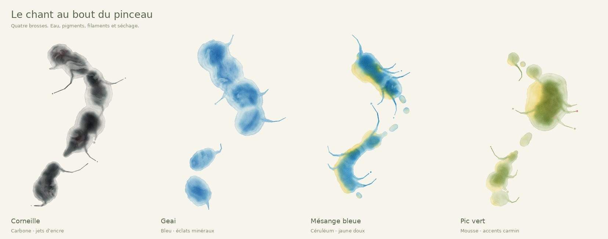

# Pinceau sonore — HAÏKUARELLE V9

Choisir une brosse d’oiseau, puis peindre directement. L’eau et le pigment sont
posés dans le même geste. Les trois pads restent remplaçables parmi sept oiseaux.
Le mouillage préalable et le glisser-déposer de sample ne sont plus nécessaires.

## Geste et voix

- Le contact sur la feuille démarre le vrai chant sélectionné. La sélection d’un pad ne joue rien.
- Glisser trace un lavis. La vitesse affine le pinceau ; la pression du stylet et la taille règlent sa largeur.
- Les attaques du chant lancent des filaments courbes effilés depuis l’épaule du lavis, parfois suivis d’une goutte détachée. Les mouvements rapides ajoutent des projections directionnelles.
- L’intensité règle l’ouverture et la charge de pigment ; la brillance sonore affine les jets. Le réglage Résonance module ces transformations.
- Lever le pinceau, annuler le contact, changer de brosse, masquer l’onglet ou perdre le focus coupe la voix et les nouveaux dépôts. La peinture déjà posée continue à diffuser et à sécher.

La phrase enregistrée est répétée pendant le contact, avec une respiration
silencieuse de 0,28 s. Aucune peinture n’est ajoutée dans les silences, sans
source ou si la lecture est bloquée. Une levée pendant le chargement invalide
la demande : aucun geste différé ne ressurgit. Pendant ce chargement, seule la
dernière position est conservée, sans rejouer un ancien trajet. Un contact
oublié s’arrête après 90 secondes.

Au clavier, choisir une brosse avec 1–3, placer le focus sur la feuille, maintenir
espace ou Entrée et déplacer le pinceau avec les flèches. Relâcher la touche
lève le pinceau. Échap arrête le contact et quitte le grand écran.

## Simulation et matière

`DirectBrush` est notre coordinateur du contact et de la source audio réelle.
Il appelle `startBirdBrush` seulement après le succès de `source.start()`, puis
transmet le trajet à `ResonantBrush`. Ce sont des modules HAÏKUARELLE, pas des
API supposées de Pigment Drift.

Chaque échantillon émet d’abord un vrai segment Water puis les segments de
pigment. Les compagnons de plumage sont posés légèrement à côté du pigment
principal. Les onze pigments stables, l’absorption RGB, les auréoles et les
masques alpha de séchage sont conservés. Le guide de l’eau est alimenté par les
segments réellement émis. La fin du geste laisse le même temps de séchage
physique que le mode eau préparée, plutôt qu’une coupure prématurée à cinq secondes.

`sonicFilament` construit quatre segments de peinture courbes et effilés. Ces
filaments sont des pigments transportés et séchés dans le champ GPU. Ils restent
présents lorsque Encre = 0. L’encre fine est une surimpression distincte, plus
discrète sur le corps des lavis. Les jets et gouttelettes sont bornés à seize
segments au total par pas, y compris les trois échantillons du pinceau et leurs
compagnons. La file des mouvements coalescés est bornée. Les boucles audio
préparées sont mises en cache pour éviter une allocation à chaque contact.

Le moteur de fluide et les shaders restent ceux de Paint Studio adaptés. Il n’y
a pas de nouveau moteur de particules, de flou de post-traitement ni de service
distant. Le format portrait, l’affichage HD et la carte PNG avec haïku demeurent.
L’ancienne méthode `wetBrush` / `startSoundStain` reste disponible dans l’API.

## Contrôles

87 tests passent : cycle audio réel, refus de lecture, annulation d’un chargement
tardif, levée, silence, trajet, largeur/vitesse, sept plumages, budgets de
segments, jets présents sans encre, cache des boucles et absence de minuterie
obsolète. TypeScript et la construction de production passent aussi.

Les sept brosses ont fait l’objet d’une première étude GL. Après l’examen des
images, les jets ont été déplacés du centre vers le bord du lavis et des gouttes
terminales ont été ajoutées. Quatre brosses ont été revues sur cette géométrie
finale : corneille, geai, mésange et pic vert. Les PNG sont calculés par les vrais
appels GL du moteur TypeScript, rejoués sur Mesa/EGL. Le rejeu du geai est
identique pixel pour pixel, de même que deux captures sans pas physique. Aucun
nouveau segment n’est émis après la levée. Export contrôlé : 2304 × 4096.
Rapport : `direct-validation-egl.json`.

Le navigateur de contrôle ne fournit pas WebGL2. L’interface et le décodage audio
y sont contrôlés, en bureau et en vue 390 × 844 ; le rendu est vérifié sur EGL.
La fluidité sur un téléphone physique reste à confirmer. La graine seule ne
mémorise pas un geste manuel : le trajet, les réglages et l’horloge audio font
aussi partie du rejeu. Les différences numériques entre GPU restent possibles.
