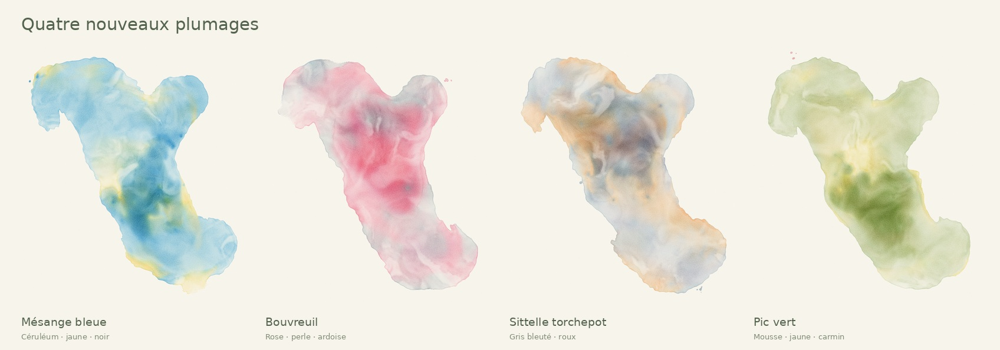

# Sept plumages — HAÏKUARELLE V8

Les trois pads visibles peuvent chacun recevoir une des sept voix. Le menu sous
le pad change sa brosse ; il ne joue rien. Mouiller la feuille, puis glisser le
sample ou choisir un point humide et appuyer sur **Déposer ici**. Les raccourcis
1–3 suivent les trois pads actuellement choisis. Les doublons de pads sont évités.

## Quatre nouvelles signatures

| Oiseau | Pigments | Gestes du chant |
| --- | --- | --- |
| Mésange bleue | Bleu céruléum, jaune doux, ponctuation noire | Fronts plus fins, ramifications, îlots jaunes séparés et encre légère. |
| Bouvreuil pivoine | Rose, gris perle et ardoise | Lavis plus larges et plus lents, ombres grises, encre moins présente. |
| Sittelle torchepot | Gris bleuté, ocre roux, trace sombre | Fronts rapides et étroits, rencontres rousses, ramifications nerveuses. |
| Pic vert | Vert mousse, jaune lichen, carmin | Fronts ondulants, poches jaunes, au plus trois projections carmin lorsque la graine en prévoit. |

L’enveloppe, les attaques et la brillance viennent du vrai signal. La forme de
l’eau reste déterminante : un chant colore toute sa flaque reliée, pas les autres
flaques. Les couleurs secondaires forment des îlots cohérents dans la feuille,
plutôt qu’une alternance aléatoire à chaque trame. Le blanc est du papier
préservé et des zones de faible concentration, sans ajout de peinture blanche.
Les auréoles et textures de séchage V7 s’appliquent aussi à ces pigments.

## Extension du moteur réellement utilisé

Paint Studio est conservé. Le mode amont possède trois encres ; V8 lui ajoute
un mode explicite d’absorption RGB, activé avec `Look.pigments`. Le même champ
RGBA16F stocke la somme d’absorption et ses composantes verte/bleue, ainsi que
l’eau. La composante rouge est le reste. Les coefficients, déposés avec le
pigment, restent transportés par l’advection et la diffusion amont.

Onze pigments stables sont définis dans `src/engine/palettes.ts`. Jusqu’à seize
peuvent être déclarés par `Look.pigments`. Le bit `wetOnly` est séparé des
identifiants de pigment. Changer de pad ne modifie pas la table ni les traces
précédentes. Aucun tampon de simulation supplémentaire n’est nécessaire. Le
mode historique à trois encres demeure disponible sans ce paramètre.

Ce mélange d’absorption est une approximation à trois canaux, sans modèle
spectral, chimique ou d’interaction propre à chaque pigment minéral. La matière
reste procédurale. La graine, la carte d’eau, les réglages et les timings sont
nécessaires pour un rejeu exact sur un même GPU.

## Enregistrements et droits

Les quatre extraits sont disponibles localement, sans compte ni clé ni appel
réseau pendant la peinture. Mésange : Dan Stowell, XC125793, via Wikimedia
Commons, CC BY-SA 3.0. Bouvreuil et sittelle : Aubrey John Williams, © The
British Library Board, CC BY-SA 4.0. Pic vert : Manudouz, CC BY-SA 4.0. Chaque
adaptation audio est distribuée sous la licence de l’original. Les trois voix
précédentes restent CC0. Sources, passages, filtrage, fondus et empreintes sont
consignés dans `public/birds/credits.json` et la page de crédits de l’application.

## Validation

79 tests passent, ainsi que TypeScript et la construction de production. Les
nouvelles grammaires sont testées avec et sans encre, avec silence et pour le
rejeu de graine, les limites de segments et les pigments autorisés. Le mécanisme
qui attend le vrai démarrage audio reste testé.

Les vrais appels GL du moteur TypeScript ont été enregistrés puis exécutés sur
Mesa/EGL. Cinq compositions distinctes (95001–95004 et 95011) ont été inspectées,
dont une rencontre mésange/bouvreuil. Le rejeu de 95001 est identique pixel pour
pixel. L’export portrait produit un PNG de 2304 × 4096. La version finale du pic
a été revue après déplacement des points rouges vers les projections périphériques.

Un contrôle sans pas physique vérifie que passer de trois à onze pigments
disponibles ne modifie aucun pixel d’une feuille déjà peinte. Un autre contrôle
dépose onze teintes sur le même champ. Les empreintes et les limites exactes de
la vérification sont dans `plumage-validation-egl.json`.

Les menus des pads et le décodage des nouveaux samples ont été vérifiés dans
le navigateur, y compris en vue 390 × 844. Ce navigateur de contrôle ne fournit
pas WebGL2 : la simulation a donc été validée sur Mesa/EGL. La fluidité sur un
téléphone physique reste à confirmer. Aucun chiffre de FPS mobile n’est revendiqué.
